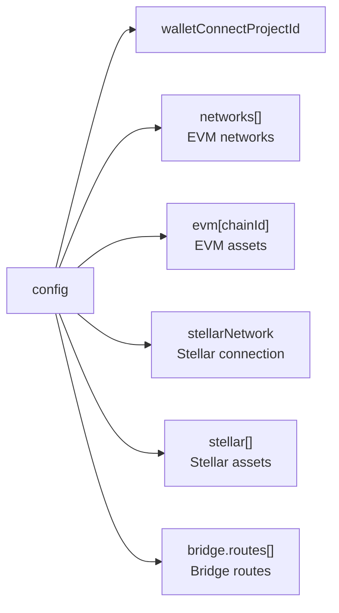
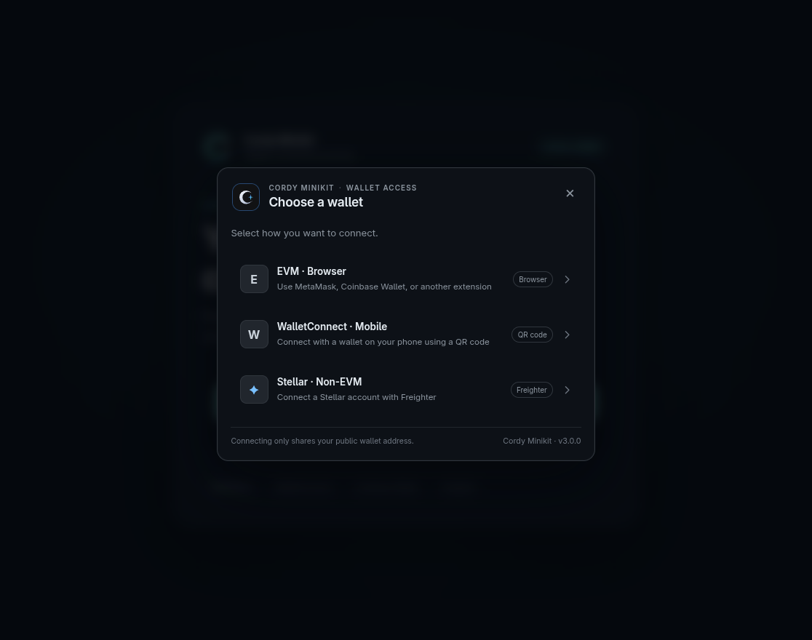
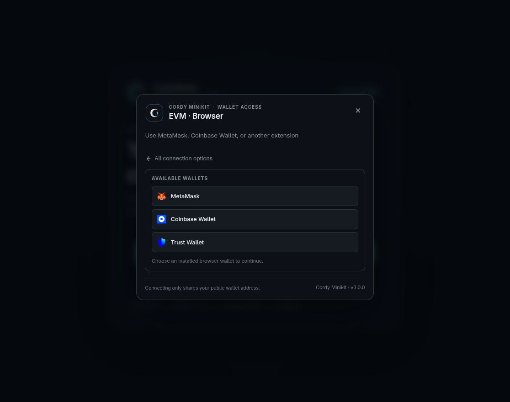
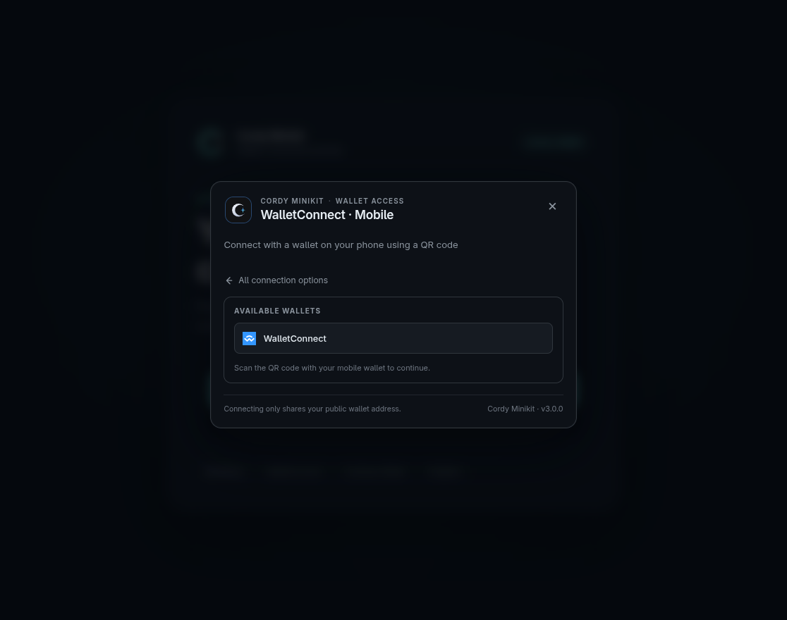

<div align="center">
  
  <h1>Cordy Minikit</h1>
  <p>Typed Web3 toolkit for EVM and Stellar wallet access, server-verified sign-in, balances, transfers, swaps, and bridges.</p>
</div>

## Configuration highlights

EVM networks are declared once under `networks`. ERC-20 assets are grouped by
chain ID under `evm`; native currencies such as ETH and BOT come from
`networks[].nativeCurrency` and should not be repeated in `evm`.

```json
{
  "networks": [
    {
      "chainId": 11155111,
      "name": "Ethereum Sepolia",
      "nativeCurrency": { "name": "Sepolia Ether", "symbol": "ETH", "decimals": 18 },
      "rpcUrl": "https://rpc.example"
    }
  ],
  "evm": {
    "11155111": [
      { "symbol": "USDC", "contractAddress": "0xToken", "decimals": 6 }
    ]
  }
}
```

Wallets may connect on another EVM network, but Cordy rejects balance,
transfer, and swap operations until that chain is configured. Bridge wallet
connection can prepare the configured route network and request its token in
wallets that support `wallet_addEthereumChain` and `wallet_watchAsset`.

## Configuration map

The demo's [`assets.json`](./demo/src/config/assets.json) keeps wallet, network,
asset, Stellar, and bridge settings in one configuration:



Native currencies belong to `networks[].nativeCurrency`; ERC-20 contracts
belong under `evm["<chainId>"]`; bridge directions and contract details belong
under `bridge.routes[]`.

<p align="center">
  <a href="https://badge.socket.dev/npm/package/@cordystackx/cordy_minikit/3.1.1">
    
  </a>
</p>

<div align="center">
  
  
  
</div>

<p align="center">
  <a href="https://www.npmjs.com/package/@cordystackx/cordy_minikit">NPM</a>
  ·
  <a href="https://github.com/cordyStackX/cordy_minikit_official">GitHub</a>
  ·
  <a href="https://github.com/cordyStackX/cordy_minikit_official/blob/main/docs/README.md">Documentation</a>
</p>

---
© 2025 Cordy StackX (@cordystackx) · Licensed under the MIT License.
---

## Install

```bash
npm install @cordystackx/cordy_minikit
# or
pnpm add @cordystackx/cordy_minikit
```

## Version 3.1.1 documentation

Read the complete documentation in the [`docs/` folder](./docs/README.md):

- [Documentation index](https://github.com/cordyStackX/cordy_minikit_official/blob/main/docs/README.md)
- [Environment configuration](https://github.com/cordyStackX/cordy_minikit_official/blob/main/docs/environment.md)
- [3.1.1 API reference](https://github.com/cordyStackX/cordy_minikit_official/blob/main/docs/api.md)
- [3.0.0 migration guide](https://github.com/cordyStackX/cordy_minikit_official/blob/main/docs/migration-3.0.0.md)
- [Provider and wallet UI setup](https://github.com/cordyStackX/cordy_minikit_official/blob/main/docs/setup.md)
- [Use Cordy functions in your app](https://github.com/cordyStackX/cordy_minikit_official/blob/main/docs/recipes.md)

## Current API

```ts
import { cordy } from "@cordystackx/cordy_minikit";

const wallet = await cordy.cons_verify();
const balance = await cordy.balance();
const transfer = await cordy.transfer("1", recipient);
await cordy.cons_disconnect();
```

The current 3.1.1 API is:

- `cordy.configure({ assets })`
- `cordy.cons_verify()`
- `cordy.cons_disconnect()`
- `useConsSession()`
- `createCordyServer()` from `@cordystackx/cordy_minikit/server`
- `cordy.transfer()`
- `cordy.balance()`
- `cordy.swap(amount, from, to, tolerancePercent?, options?)`
- `cordy.bridge(amount, from, to, recipient, options?)`

With `cons_session={true}`, `ConnectWalletBT` requests a wallet signature, verifies SIWE (EVM) or SEP-10 (Stellar) through your server, and navigates only after verification succeeds. Mount the SDK server handler and configure it with `createCordyServer()`; the SDK never reads environment variables. `cordy.cons_verify()` and `useConsSession()` read the resulting server session, while `cordy.cons_disconnect()` clears the session and disconnects wallets. See the [authentication guide](./docs/api.md#server-authentication). Keep signing keys in server-only environment variables and never pass them to client components.

## Bridge API

`cordy.bridge()` is a supported API in 3.1.0. Configure routes in `assets.bridge.routes`; pass `{ routeId }` when more than one route is configured. The demo includes BOT Chain Testnet ↔ Sepolia and BOT Chain Testnet ↔ BNB Testnet validator routes, plus Stellar Testnet ↔ Sepolia CCTP for USDC. EVM validator delivery is asynchronous; CCTP completes through attestation and destination mint. See the [bridge route configuration](./docs/environment.md#bridge-routes), [API example](./docs/api.md#cordybridgeamount-from-to-recipient-options), and [Use Cordy functions in your app](./docs/recipes.md).

`cordy.swap(amount, from, to, tolerancePercent?, options?)` is available for configured EVM and Stellar assets. EVM networks can configure a V2 `swapRouterAddress`, V3 `swapV3` router and QuoterV2, or both. The default `auto` mode compares configured quotes; use `{ version: "v2" }` or `{ version: "v3" }` to choose explicitly. Pass `feeTiers: [500, 3000]` in the options to override the configured V3 tiers for one call; with `version: "auto"`, V2 is still compared against only those selected V3 tiers. The tiers `500`, `3000`, and `10000` correspond to pool fees of 0.05%, 0.30%, and 1.00%. Every network needs compatible deployments, fee tiers, token addresses, and available liquidity. Native EVM swaps also need `wrappedNativeTokenAddress`. Stellar swaps use Horizon strict-send path payments and require a live liquidity path. The tolerance argument is a percentage: `1` means 1% tolerance, and omission defaults to 1%.

## Links

- [NPM package](https://www.npmjs.com/package/@cordystackx/cordy_minikit)
- [GitHub repository](https://github.com/cordyStackX/cordy_minikit_official)
- [Changelog](https://github.com/cordyStackX/cordy_minikit_official/blob/main/CHANGELOG.md)
- [Contributing guide](https://github.com/cordyStackX/cordy_minikit_official/blob/main/CONTRIBUTING.md)
- [Security policy](https://github.com/cordyStackX/cordy_minikit_official/blob/main/SECURITY.md)
