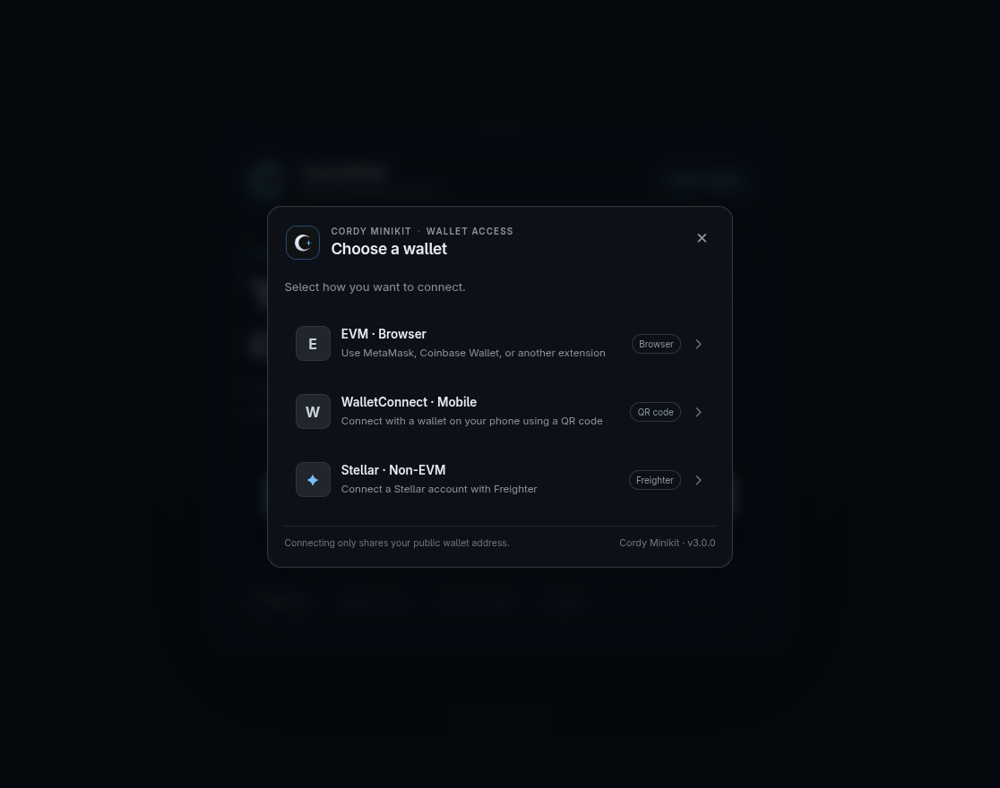
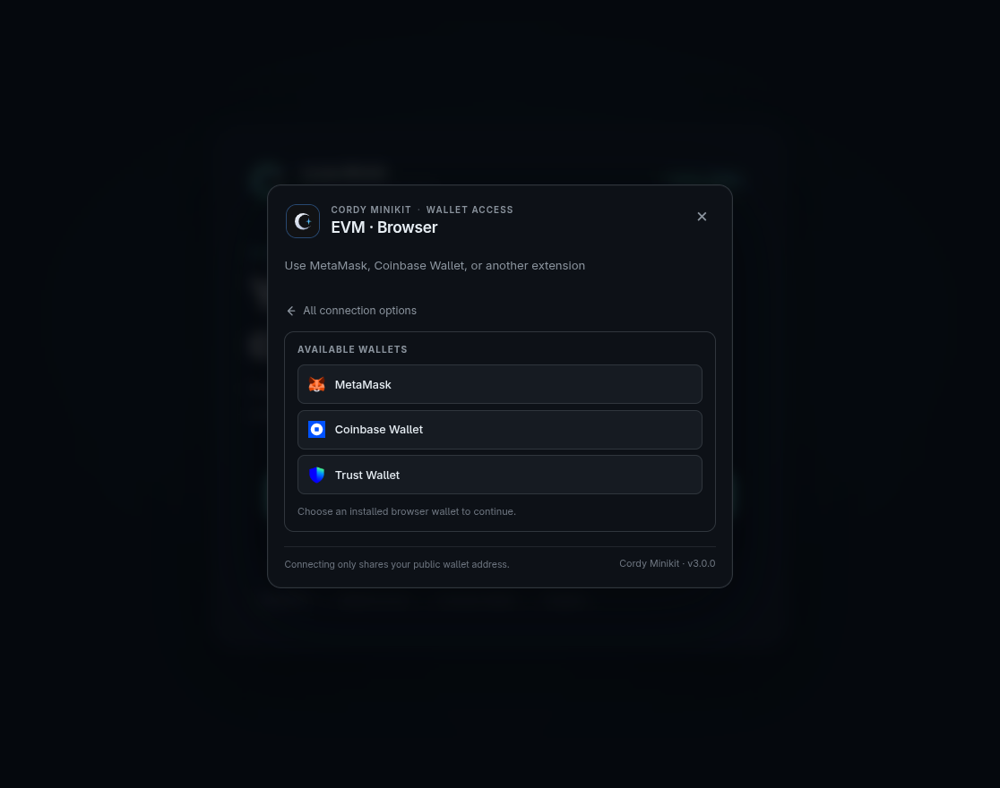
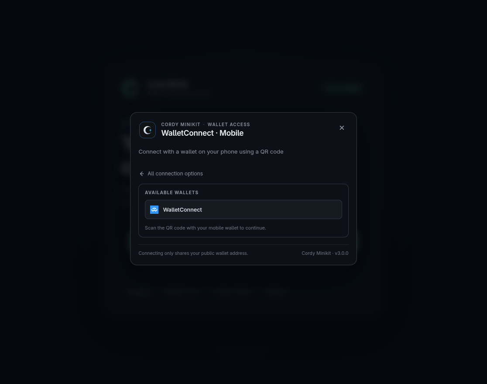

<div align="center">
  
  <h1>Cordy Minikit</h1>
  <p>Typed Web3 toolkit for EVM and Stellar/Soroban wallet connections, balances, transfers, and session helpers.</p>
</div>

<div align="center">
  
  
  
</div>

<p align="center">
  <a href="https://www.npmjs.com/package/@cordystackx/cordy_minikit">NPM</a>
  ·
  <a href="https://github.com/cordyStackX/cordy_minikit_official">GitHub</a>
  ·
  <a href="./docs/README.md">Documentation</a>
</p>

---
© 2025 Cordy StackX (@cordystackx) · Licensed under the MIT License.
---

## Install

```bash
npm install @cordystackx/cordy_minikit
# or
pnpm add @cordystackx/cordy_minikit
```

## 3.0.0 documentation

Read the complete documentation in the [`docs/` folder](./docs/README.md):

- [Documentation index](./docs/README.md)
- [Environment configuration](./docs/environment.md)
- [3.0.0 API reference](./docs/api.md)
- [3.0.0 migration guide](./docs/migration-3.0.0.md)
- [Provider and wallet UI setup](./docs/setup.md)
- [Server session endpoint examples](./docs/server-endpoints.md)

## Current API

```ts
import { cordy } from "@cordystackx/cordy_minikit";

const session = await cordy.jwt_verify();
const balance = await cordy.balance();
const transfer = await cordy.transfer("1", recipient);
await cordy.jwt_disconnect();
```

The current 3.0.0 API is:

- `cordy.jwt_verify()`
- `cordy.jwt_disconnect()`
- `cordy.transfer()`
- `cordy.balance()`
- `cordy.swap(amount, from, to)`

`cordy.jwt_confirm()` remains available as a deprecated compatibility alias for `cordy.jwt_verify()`. Legacy controller helpers remain available for compatibility, but new integrations should use the `cordy.*` API.

## Planned APIs

**Experimental in 3.0.0:** `cordy.bridge()` currently supports test USDT between BOT Chain Testnet and Ethereum Sepolia only. See the [bridge API example](./docs/api.md#cordybridgeamount-from-to-recipient).

`cordy.swap(amount, from, to)` is available for configured EVM and Stellar assets. EVM networks need a Uniswap V2-compatible `swapRouterAddress`; native EVM swaps also need `wrappedNativeTokenAddress`. Stellar swaps use Horizon strict-send path payments and require a live liquidity path. Both use 1% minimum-output tolerance.

## Links

- [NPM package](https://www.npmjs.com/package/@cordystackx/cordy_minikit)
- [GitHub repository](https://github.com/cordyStackX/cordy_minikit_official)
- [Demo](./demo/README.md)
- [Changelog](./CHANGELOG.md)
- [Contributing guide](./CONTRIBUTING.md)
- [Security policy](./SECURITY.md)
